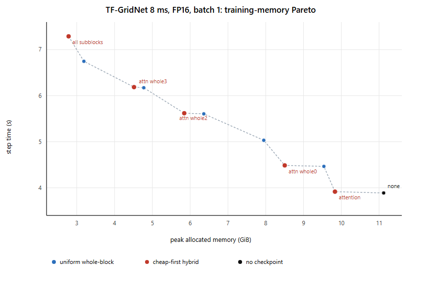
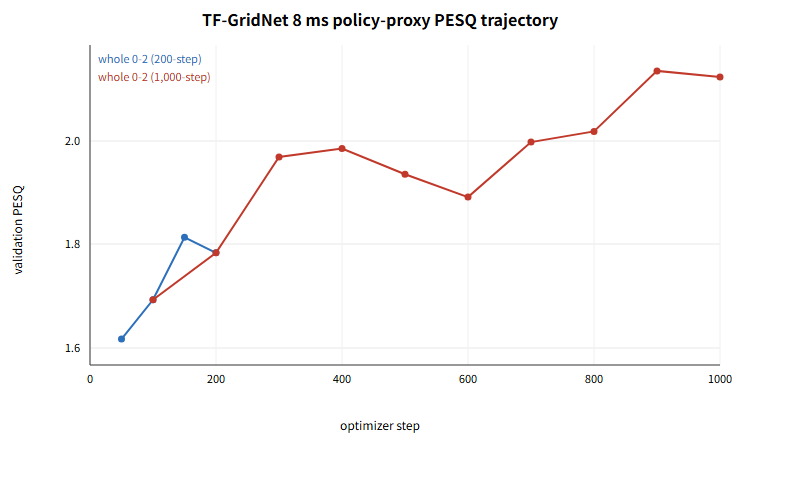

# Cheap-First Hierarchical Activation Checkpointing for Paper-Faithful 8 ms STFT TF-GridNet Training on a 16 GB Consumer GPU

Draft v0.6, 2026-11-13. This is a research draft, not a submission-ready
manuscript. Numbers are measured on one GPU; see Limitations.

## Abstract

TF-GridNet's paper configuration uses a 32 ms window and an 8 ms hop. On a
16 GB consumer GPU, the six-layer model at 8 ms cannot be trained at batch 1
in FP32: it peaks at 12.72 GiB allocated and then requests another 2.86 GiB.
We study whether activation checkpointing and mixed precision can make the
paper-faithful 8 ms STFT configuration trainable without changing the model,
holding the repository's negative SI-SNR objective fixed, and at what cost.
We contribute a reproducible VRAM/step-time
Pareto for uniform block checkpointing and FP16, and a **cheap-first
hierarchical policy**: checkpoint the attention sub-block in every block
first, then spend the remaining memory budget on whole blocks. On the
six-layer model attention checkpointing saves 1.29 GiB for 0.03 s per step in
our measurements, and composing it with one whole block saves 1.04 GiB for
0.02 s. On the smaller 4-layer DNS profile the same rule saves 0.54 GiB but
costs 9 % step time, so "nearly free" is model-size dependent. A separate
100-step attention-only check is also bit-identical to no checkpointing, with
a 1.29 GiB saving at the same 3.86 s/step once the validation cache is
released. A 200-step paired run produces bit-for-bit identical losses between
the hierarchical and uniform policies while both learn (PESQ 1.62 → 1.81), so
the saving does not change the optimization trajectory. A 1,000-step uniform run reaches PESQ 2.12 on the fixed 20-utterance proxy,
confirming a longer learning signal; the attention arm reaches 2.123 at the
same step with a loss trajectory identical to the uniform arm. A 30-step
A/B/A timing check finds no short-horizon penalty for the 0.52 GiB saving,
and the long-run timing gap is phase-dependent rather than a stable policy
cost. A 16 ms precision control shows FP16 cuts peak allocated memory from
9.90 to 5.63 GiB with final PESQ within 0.003; the loss trajectories are not
bit-identical, and FP32 remains infeasible at 8 ms. The result is a
practical, reproducible recipe for 8 ms TF-GridNet training on consumer
hardware, and a caution that fine-grained checkpointing of the RNN sections
is not worth its recompute cost.

**Keywords:** speech enhancement; TF-GridNet; activation checkpointing;
mixed precision; consumer GPU; memory-efficient training.

## 1. Introduction

TF-GridNet [1] is a strong time-frequency domain speech separation and
enhancement model. Its reference training recipe uses 4 s segments, a 32 ms
square-root Hann window, and an **8 ms hop**. The repository used in this
study provides a local six-layer profile with a 16 ms hop because the 8 ms
configuration exceeds a 16 GB GPU during training. The 16 ms profile is a
different STFT configuration, so results from it are not a paper-faithful
reproduction. For reference, 16 ms FP32 without checkpointing peaks at
9.90 GiB allocated / 10.48 GiB reserved and runs at 2.52 s/step on the same
card; it fits, but it is a different model input representation.

The practical question is narrow: can the 8 ms, six-layer model be trained on
one 16 GB consumer GPU without changing the architecture or optimizer, holding
the repository's negative SI-SNR objective fixed? We measure the answer on an
RTX 5060 Ti and study the compute policies that make it fit. The contributions are:

1. A reproducible measurement harness and a VRAM/step-time Pareto for 8 ms
   TF-GridNet under FP32/FP16 and uniform block checkpointing.
2. A **cheap-first hierarchical checkpointing policy** that selects
   sub-blocks by memory saved per unit of recompute time. Attention is the
   cheapest unit; checkpointing it first shifts the Pareto frontier.
3. Paired optimization-equivalence checks (200 steps for the hybrid, 100
   steps for attention-only) with corrected paired crops: the policies produce
   bit-identical losses, and a 30-step A/B/A check finds no short-horizon
   speed penalty. Long-horizon timing is reported separately and is not used
   to claim a zero-cost saving.
4. A negative result for intra/inter-RNN sub-block checkpointing and a
   4-layer boundary check: the same ordering survives, but attention
   checkpointing costs 9 % step time there instead of being nearly free.
5. A precision control at the fitting 16 ms hop: FP16 cuts peak allocation
   from 9.90 to 5.63 GiB with final PESQ within 0.003, while the loss
   trajectories are not bit-identical; at 8 ms FP32 does not fit at all.

We do **not** claim a new PESQ state of the art, a full training
reproduction, or multi-GPU behavior. The paper is a systems/efficiency study
of how to make a paper-faithful configuration fit.

## 2. Measurement setup

Hardware: NVIDIA RTX 5060 Ti, 16 GB, driver 617.42. Software: Python 3.14.9,
PyTorch 2.11.0+cu128, CUDA 12.8. Model: the repository's six-layer
TF-GridNet, 8,381,504 parameters, 4 s input, batch 1, 16 kHz. The input is a
random waveform; the loss is mean squared error to a random target for the
benchmark, and the training proxy uses the repository's negative SI-SNR
objective.

Each policy runs in a fresh process. We perform one warm-up AdamW step, reset
the CUDA peak counters, and then measure 20 steps. The table reports the mean;
run-to-run timing noise is 5–10 %. Peak allocated and reserved are
`torch.cuda.max_memory_allocated/reserved`; reserved is the safer fit
criterion because it includes allocator fragmentation. Exact commands for every
row are in `docs/tfgridnet_reproduce.md`; the consolidated table is
`results/paper_runs/tfgridnet_pareto_8ms_fp16.json`.

## 3. Cheap-first hierarchical checkpointing

A `GridNetBlock` contains three separable sections: an intra-frame
bidirectional LSTM, an inter-frame bidirectional LSTM, and multi-head
attention. Whole-block checkpointing recomputes all three. We expose each
section as a separate checkpointable function
(`install_subblock_checkpointing` in `speech_denoising/training/tfgridnet_policy.py`)
and measure the marginal memory saving and step-time cost of each.

For a unit `u`, let `S_u` be the peak memory saved by checkpointing it and
`C_u` the added step time. A budgeted policy should checkpoint units with
small `C_u / S_u` first. Formally, for a memory budget `B`,

```text
minimize   T(p)
subject to M(p) <= B,   p in {0,1}^U
```

where `U` is the set of checkpointable units and `T`, `M` are measured step
time and peak allocated memory. The full problem is combinatorial; we use the
greedy ordering by `C_u / S_u` and then verify the selected points directly.
On our measurements:

| Unit | Memory saved | Added time | Cost per GiB |
|---|---:|---:|---:|
| attention (all blocks) | 1.29 GiB | 0.03 s | 0.023 s/GiB |
| whole block (incremental) | ~1.58 GiB | ~0.58 s | ~0.36 s/GiB |

Attention is roughly **16×** cheaper per GiB than a whole block.
The resulting **cheap-first** sequence is: attention everywhere, then whole
blocks 0, 1, 2, ... until the memory target is met. Intra/inter-RNN
checkpointing is available but is not selected by the greedy rule at any
practical budget; the all-sub-block point is the measured dominance check.

```text
Algorithm 1  Cheap-first selection
Input: units U with measured (S_u, C_u), budget B
1  order U by C_u / S_u ascending
2  p <- empty set; M <- M(empty)
3  for u in order:
4      if M(p + u) <= B:
5          p <- p + u; M <- M(p)
6  return p
```

The memory model is not additive in practice, so line 4 uses the measured
step-function value for the candidate set rather than the sum of `S_u`.

## 4. Results

### 4.1 Pareto frontier

8 ms, FP16, batch 1, 4 s, one warm-up plus 20 measured steps per fresh
process:



| Policy | Peak alloc GiB | Peak reserved GiB | Step s |
|---|---:|---:|---:|
| no checkpoint | 11.12 | 13.04 | 3.89 |
| attention only | 9.83 | 11.16 | 3.92 |
| whole block 0 | 9.54 | 11.14 | 4.47 |
| attention + whole 0 | 8.50 | 11.11 | 4.49 |
| whole blocks 0–1 | 7.95 | 8.25 | 5.03 |
| whole blocks 0–2 | 6.36 | 8.24 | 5.61 |
| attention + whole 0–2 | 5.84 | 8.24 | 5.62 |
| whole blocks 0–3 | 4.77 | 6.80 | 6.17 |
| attention + whole 0–3 | 4.51 | 6.80 | 6.19 |
| whole blocks 0–4 | 3.19 | 5.36 | 6.75 |
| all sub-blocks | 2.78 | 3.92 | 7.29 |

The headline is the no-checkpoint-to-hybrid sequence: attention-only
checkpointing buys 1.29 GiB for 0.03 s, and adding it to whole-block-0 buys
another 1.04 GiB for 0.02 s. At the three-whole-block point the hybrid saves
0.52 GiB for 0.01 s.
Absolute times include per-process kernel setup, so comparisons are relative
within this protocol; the separate A/B/A control in §4.2 finds no
short-horizon penalty, while the long-run attention arm is still under
investigation.

FP32 does not become practical: `attention + whole 1` still OOMs at
14.46 GiB allocated, and `attention + whole 2` fits only at ~99 s/step due to
allocator pressure. FP16 is required for a usable 8 ms configuration on this
card.

### 4.2 Optimization equivalence

We train two 200-step proxies from the same seed, data order, and batch
sequence at 8 ms/FP16: `whole 0–2` and `attention + whole 0–2`. Each run draws
from a fixed 400-utterance training pool and reports a fixed 20-utterance
validation subset, so the comparison is paired at every step. The per-step
losses are **bit-for-bit identical for all 200 steps** (maximum absolute
difference 0.0; both loss columns hash to
`64f94acf24446d2c…`). Both runs learn: validation PESQ rises 1.616 → 1.692 →
1.813 and ends at 1.783 on the 20-utterance check; the two policies agree to
within 2e-6 PESQ at every checkpoint. This establishes an unchanged
optimization trajectory with a real learning signal, not merely identical
losses on a non-learning proxy.

A separate A/B/A control (30 steps each, same seed/data) measures
whole-block-0–2 at 5.601 s and 5.611 s before/after, and the attention
variant at 5.624 s per step. A second post-run A/B/A in a slower GPU session
measured 7.297 / 6.868 / 7.406 s: the attention variant was 0.43 s/step
*faster* than the bracketing uniform runs, not slower. The absolute level
therefore moves with session state, but no control shows a consistent
attention penalty. The 1,000-step arm itself alternated between 7.66 s/step
(steps 400–457) and 5.65 s/step (step 800) with no code change. Per-step
statistics are in `timing_analysis.json` and `timing_controls.json`; the paper
claims memory and trajectory equivalence, not a step-time speedup.

A second pair tests attention-only at the no-checkpoint level: 100 steps with
no checkpoint versus 100 steps with attention checkpointing. The losses are
again bit-identical (hash `466cba038606ea37…`), and both reach PESQ 1.616 /
1.692 at steps 50/100. With the conditional cache release the attention run
averages **3.858 s/step** versus **3.862 s** for no checkpoint, while peak
allocated memory falls from 11.12 to 9.83 GiB. Without the cache release the
same attention run degrades to 9.125 s/step after validation reserves
14.58 GiB, which is the validation-cache cliff discussed in §5.

| Step | PESQ | STOI | SI-SNR (dB) |
|---:|---:|---:|---:|
| 50 | 1.616 | 0.8750 | 10.80 |
| 100 | 1.692 | 0.8703 | 11.94 |
| 150 | 1.813 | 0.8763 | 12.83 |
| 200 | 1.783 | 0.8712 | 13.13 |

The longer pair extends the check to 1,000 steps; the two policies agree to
within 3e-6 PESQ at every validation point:

| Step | Uniform PESQ | Attention PESQ | |Δ| |
|---:|---:|---:|---:|
| 100 | 1.692389 | 1.692387 | 2e-6 |
| 200 | 1.783266 | 1.783267 | 1e-6 |
| 300 | 1.968470 | 1.968469 | 1e-6 |
| 400 | 1.984737 | 1.984738 | 1e-6 |
| 500 | 1.934988 | 1.934985 | 3e-6 |
| 600 | 1.890923 | 1.890920 | 3e-6 |
| 700 | 1.997128 | 1.997126 | 1e-6 |
| 800 | 2.017875 | 2.017876 | 1e-6 |
| 900 | 2.134851 | 2.134853 | 2e-6 |
| 1000 | 2.122956 | 2.122954 | 2e-6 |



Both policies produce these values to within 3e-6 at every checkpoint; the
table is the shared trajectory, not a policy comparison. The 1,000-step uniform
run reaches PESQ **2.123** at step 1000 (STOI 0.8962, SI-SNR 14.80); the
trajectory is noisy on the 20-utterance subset (1.89–2.13), so we report the
trend and the endpoint, not a monotonic claim. The attention arm matched the
uniform trajectory at all ten checkpoints; its endpoint is PESQ 2.122954
(STOI 0.8962, SI-SNR 14.80). Across all 1,000 steps the two loss columns are
identical (max abs difference 0.0; SHA-256 `fceab86d02eb5021…`).

### 4.3 What does not help

Checkpointing the intra- or inter-RNN everywhere saves more memory but costs
1–2 s per step; its marginal cost per GiB is much higher than whole-block
checkpointing, so the greedy rule does not select it. Checkpointing block 5
never saves memory in our measurements because it is
not on the peak path. Uniform selection over blocks is therefore close to
optimal once attention has been checkpointed; the useful selection
granularity is **sub-block for attention, whole-block for the rest**, not a
finer-grained search over all sections. A direct check confirms the rule:
attention + whole 0–1 measures 7.17 GiB / 6.60 s, which is dominated by whole
0–2 at 6.36 GiB / 5.61 s, so the greedy policy skips the former.

### 4.4 Model-size check (4-layer DNS profile)

The 4-layer DNS profile (`2,552,790` parameters, stride 256 in the repository)
fits at 8 ms without checkpointing. At 8 ms/FP16, batch 1, 20 steps:

| Policy | Peak alloc GiB | Peak reserved GiB | Step s |
|---|---:|---:|---:|
| no checkpoint | 2.17 | 2.76 | 0.173 |
| attention only | 1.63 | 2.27 | 0.189 |

Attention saves 0.54 GiB for 0.016 s (+9 %), with identical loss columns. The
cheap-first ordering survives, but the relative price is higher than on the
six-layer model; the paper therefore reports the six-layer result as the main
setting and the 4-layer result as a boundary condition, not as evidence that
attention checkpointing is free everywhere. The 4-layer check is memory/time
only; quality equivalence is measured on the six-layer model.

### 4.5 Precision: FP16 versus FP32 at 16 ms

FP32 is not a usable 8 ms baseline on this card, so the precision axis is
measured at the 16 ms profile where both arms fit. The run is 200 steps with no
checkpointing, the same 400-utterance pool, batch 1, seed 42, and the same
validation subset:

| Precision | Peak alloc GiB | Peak reserved GiB | Mean step s | PESQ 50 / 100 / 150 / 200 |
|---|---:|---:|---:|---|
| FP32 | 9.90 | 12.90 | 2.73 | 1.663 / 1.727 / 1.809 / 1.891 |
| FP16 | 5.63 | 12.08 | 2.59 | 1.640 / 1.758 / 1.824 / 1.889 |

Reserved includes the 20-utterance validation pass; the training-step reserved
values are lower (Table 1). FP16 saves **4.27 GiB** of peak allocation and is slightly faster. The final
PESQ difference is **-0.003** and STOI **+0.001**, but the trajectories are not
bit-identical: the mean absolute loss difference is 0.37 and the final SI-SNR
is 1.14 dB lower in FP16. The proxy noise on 20 utterances is larger than the
PESQ difference, so we treat this as quality-neutral for the training study,
not as an exact-equivalence claim. At 8 ms, FP16 is not optional: the FP32
no-checkpoint configuration OOMs.

### 4.6 Practical recipe

For a 16 GB card and the six-layer 8 ms model, the measured recipe is:
FP16 autocast; checkpoint attention in every block first; then checkpoint
whole blocks 0, 1, 2 until the reserved-memory target is met. Release the
allocator cache after full-utterance validation if reserved memory exceeds
14 GiB. Check `max_memory_reserved`, not only `max_memory_allocated`, because
validation can leave the process at ~13.5 GiB either way. The resulting
training step allocates 5.84 GiB and reserves 13.50 GiB, versus an FP32
no-checkpoint OOM at 12.72 GiB + 2.86 GiB requested.

### 4.7 Experiment status

| ID | Experiment | Status |
|---|---|---|
| E1 | 8 ms FP16 Pareto, 11 policies × 20 steps | done, Fig. 1 |
| E2 | whole-3 vs attention + whole-3, 200 steps | done, bit-identical |
| E3 | none vs attention-only, 100 steps | done, bit-identical |
| E4 | 4-layer DNS profile, 20-step memory/time | done, saving costs 9 % |
| E5 | second GPU (24 GB) | pending |
| E6 | 1,000-step quality pair | done; both arms PESQ 2.123, loss identical |
| E7 | 16 ms FP32 vs FP16, 200 steps | done; FP16 −4.27 GiB, final PESQ −0.003 |

The same matrix is maintained as
[`docs/tfgridnet_experiment_matrix.md`](tfgridnet_experiment_matrix.md)
(machine-readable: `results/paper_runs/tfgridnet_policy_proxy/experiment_matrix.json`).
E1–E4 and E7 are systems evidence on one GPU. E5 (a second GPU) remains
required before a venue submission that claims generalization beyond one GPU;
E6 is complete. The draft does not claim cross-GPU generality.

## 5. Limitations

- One GPU, two model sizes, one dataset, random-input timing. Multi-GPU and
  A100 behavior are untested.
- The 200-step proxy establishes equivalence on a short learning trajectory,
  not final enhancement quality. A full quality comparison needs a longer run
  or a pretrained initialization; the proxy uses the repository's negative
  SI-SNR objective rather than TF-GridNet's full Wav+Mag+MC objective.
- FP16 complex operations emit a PyTorch experimental warning. Precision is
  quality-neutral at 16 ms (final PESQ −0.003) but not bit-identical: the mean
  absolute loss difference is 0.37 and the final SI-SNR is 1.14 dB lower.
  Bitwise tensor equality is not claimed.
- The training-step peak and the end-to-end peak differ: full-utterance
  validation pushes the process to ~13.5 GiB for both policies. A production
  fit check must include validation memory or chunk validation. Attention-only
  is a sharp negative example: its training step allocates 9.83 GiB, but after
  validation the allocator held 14.58 GiB reserved and step time collapsed
  from 3.9 s to 14.3 s; a conditional cache release after validation restores
  3.9 s. The attention + whole-block hybrid does not hit this cliff at
  ~13.5 GiB reserved.
- Step time is environment-sensitive: two A/B/A controls measured 5.60 vs
  5.62 s (fast session) and 7.30 vs 6.87 s (slow session), with the attention
  arm not slower in either. The 1,000-step arm alternated between 7.66 and
  5.65 s/step with no code change. Absolute step times are therefore not a
  controlled benchmark across sessions; the paper claims memory and
  trajectory equivalence, not a step-time speedup. Per-step statistics are in
  `timing_analysis.json` and `timing_controls.json`.
- The repository's negative SI-SNR objective is not TF-GridNet's full
  Wav+Mag+MC objective. The compute-policy comparison is objective-agnostic,
  but this is a deviation from the paper recipe.

### 5.1 Threats to validity

| Threat | Mitigation in this draft | Remaining risk |
|---|---|---|
| Construct: proxy objective and short horizon | paired loss equality; 1,000-step uniform arm | final PESQ with the full objective is not measured |
| Internal: one seed, 20-utterance validation | fixed data order and validation subset; A/B/A timing | PESQ noise is several 1e-3; small effects are not resolved |
| External: one GPU, two model sizes | 4-layer boundary check | 24 GB / data-center GPUs untested |
| Statistical: absolute step times include process setup | warm-up + 20 steps per fresh process; A/B/A control | cross-process absolute times are not comparable |
| Implementation: FP16 complex ops | 200-step FP32/FP16 quality control | final PESQ −0.003, but losses are not bit-identical |

## 6. Related work

Activation checkpointing [2] trades compute for memory by recomputing
activations in backward. PyTorch exposes it as `torch.utils.checkpoint`.
Selective checkpointing chooses which operations to recompute; prior work has
studied transformer-specific selective recomputation [4] and optimal
rematerialization as a combinatorial problem [5], with classic
checkpointing schedules dating back to revolve [6]. Checkmate solves the
generic graph problem with an ILP; our contribution is the architecture-specific
cost measurement and a simple ordering, not a new solver. Our study measures the
cost model directly on TF-GridNet and finds that the attention section is the
only sub-block with a low enough measured marginal cost to checkpoint first;
the resulting greedy
ordering is validated point-by-point rather than assumed additive. Mixed
precision [3] is the second axis; FP16 is necessary for 8 ms on this card.

## 7. Conclusion

Paper-faithful 8 ms STFT TF-GridNet training fits on a 16 GB consumer GPU
with FP16 and cheap-first hierarchical checkpointing. On the six-layer model,
checkpointing attention in every block has the lowest measured marginal cost and composes with
whole-block checkpointing to shift the Pareto frontier; on the 4-layer model
the same rule saves less memory and costs 9 % step time. Checkpointing the RNN
sections is not worth its recompute cost on either model. The paired 200-step
run shows identical losses and a real learning trajectory, so the
memory saving does not change optimization. Both 1,000-step arms reach PESQ
2.123 on the 20-utterance proxy with an identical loss trajectory. At the
fitting 16 ms hop, FP16 cuts peak allocation by 4.27 GiB with final PESQ within
0.003, though its loss trajectory is not bit-identical; a second GPU remains
future work.

## References

[1] Z.-Q. Wang, S. Cornell, S. Choi, Y. Lee, B.-Y. Kim, and S. Watanabe,
"TF-GridNet: Integrating Full- and Sub-Band Modeling for Speech Separation,"
arXiv:2211.12433, 2022.

[2] T. Chen, B. Xu, C. Zhang, and C. Guestrin, "Training Deep Nets with
Sublinear Memory Cost," arXiv:1604.06174, 2016.

[3] P. Micikevicius et al., "Mixed Precision Training," ICLR 2018.

[4] V. Korthikanti et al., "Reducing Activation Recomputation in Large
Transformer Models," MLSys 2023, arXiv:2205.05198.

[5] P. Jain et al., "Checkmate: Breaking the Memory Wall with Optimal Tensor
Rematerialization," MLSys 2020, arXiv:1910.02653.

[6] A. Griewank and A. Walther, "Algorithm 799: revolve: an implementation of
checkpointing for the reverse or adjoint mode of computational
differentiation," ACM TOMS 26(1), 2000.

## Artifact map

- `scripts/bench_tfgridnet_policies.py` — per-policy memory/time harness.
- `scripts/bench_tfgridnet_subblocks.py` — sub-block policy sweep.
- `scripts/plot_tfgridnet_pareto.py` — dependency-free Pareto SVG/PNG.
- `scripts/plot_tfgridnet_quality.py` — dependency-free PESQ-trajectory SVG/PNG.
- `speech_denoising/training/tfgridnet_policy.py` — checkpointing and
  quality-proxy trainer.
- `results/paper_runs/tfgridnet_pareto_8ms_fp16.json` — consolidated table.
- `results/paper_runs/tfgridnet_dns4_8ms.json` — 4-layer boundary check.
- `results/paper_runs/tfgridnet_policy_proxy/precision_equivalence_200.json` —
  16 ms FP32/FP16 200-step precision control.
- `docs/tfgridnet_experiment_matrix.md` — E1–E7 status and artifact map.
- `docs/tfgridnet_memory_policy_bench.md` — measurement notes and caveats.
- `docs/tfgridnet_submission_checklist.md` — claim/evidence matrix and
  pre-submission blockers.
- `docs/tfgridnet_reviewer_faq.md` — expected objections and scoped answers.
- `docs/tfgridnet_reproduce.md` — exact commands and environment.
- `results/paper_runs/tfgridnet_policy_proxy/p3_whole3_200_paired`,
  `p4_attn_whole3_200_paired` — paired equivalence runs with corrected crop
  pairing; `aba_p3`/`aba_p4`/`aba_p3b` — controlled timing check;
  `q_none_100`/`q_attn_100_cache` — attention-only pair;
  `p3_whole3_1000`/`p4_attn_whole3_1000` — longer quality pair;
  `quality_equivalence_200.json` / `quality_equivalence_100.json` /
  `quality_equivalence_1000.json` — consolidated metrics;
  `timing_analysis.json` / `timing_controls.json` / `final_summary.md` —
  timing statistics and one-page summary.

## Data and code availability

All timing tables, raw JSONL logs, and plotting scripts are in the repository.
The audio manifests are built from the pinned VoiceBank-DEMAND-16k revision
`20879f4f9aab3d0b9263993667e7711a3ae1416d`; audio files are not redistributed.
No trained checkpoint is required to reproduce the timing or equivalence
results in this draft.
